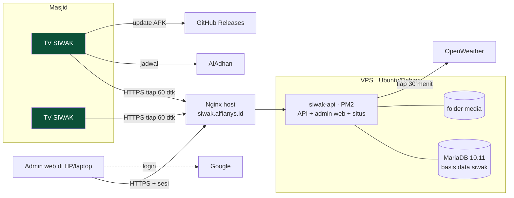
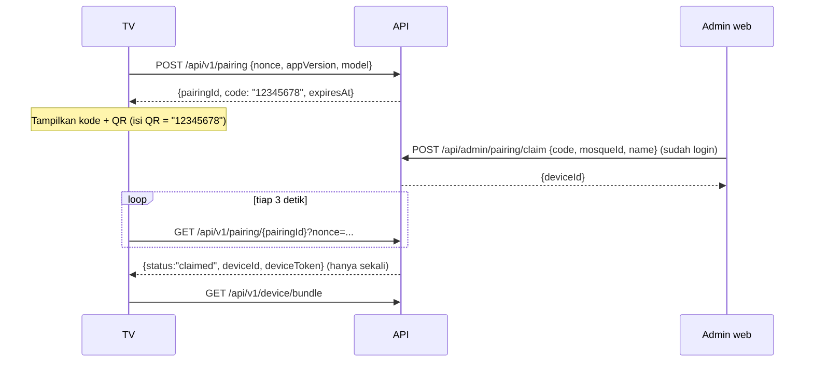

# 02 · Technical Requirements Document (TRD) · SIWAK V2

| | |
|---|---|
| **Versi dokumen** | 1.1 · 2026-11-16 (Node.js + PM2, MariaDB, siwak.alfianys.id) |
| **Mengacu pada** | [01-PRD](01-PRD.md) (ID kebutuhan `F-*`, `NF-*`) |

Dokumen ini menjawab **bagaimana** SIWAK V2 dibangun. Bila ada yang belum diatur di sini,
putuskan dulu dan tambahkan ke dokumen ini sebelum menulis kode.

---

## 1. Arsitektur



Prinsip:

1. **Jadwal shalat dihitung di TV**, bukan di server (NF-01, F-TV-05).
2. **Server adalah sumber utama** pengaturan dan konten untuk TV yang terhubung (F-TV-17).
3. **TV menarik data** (pull) dengan interval tetap. Tidak ada koneksi permanen, sehingga tahan
   jaringan buruk dan NAT.
4. **Rahasia hanya di server** (`.env`), tidak di aplikasi maupun repositori.

## 2. Teknologi

### 2.1 Server (`siwak-server`)

| Bagian | Pilihan | Catatan |
|---|---|---|
| Runtime | Node.js 22 LTS atau lebih baru | Dijalankan PM2 |
| Bahasa | TypeScript 5 (strict) | Dikompilasi ke JavaScript sebelum dijalankan di server |
| Kerangka web | Fastify 5 | Plugin: `@fastify/cookie`, `@fastify/static`, `@fastify/multipart`, `@fastify/rate-limit`, `@fastify/helmet` |
| Validasi | Zod | Satu skema dipakai untuk validasi input dan tipe |
| Database | MariaDB 10.11 | Driver `mysql2`; koneksi memakai `time_zone = '+00:00'` |
| ORM & migrasi | Drizzle ORM + drizzle-kit (dialek `mysql`) | Migrasi SQL tersimpan di repo |
| Login Google | `openid-client` | OIDC Authorization Code + PKCE, scope `openid email profile` |
| Gambar | `jimp` + `@jsquash/webp` (libwebp WebAssembly) | Konversi ke WebP, perkecil, hapus metadata EXIF. Bukan `sharp`: libvips bawaannya berlisensi LGPL-3.0 dan butuh modul native |
| Deteksi berkas | `file-type` | Cek jenis berkas dari isi, bukan nama |
| Audio | `music-metadata` | Membaca durasi audio (maks. 6 menit) |
| Unggahan | `@fastify/multipart` | Satu berkas per permintaan, maks. 10 MB |
| Log | pino (JSON ke stdout) | |
| Uji | Vitest + `fastify.inject` | Database uji terpisah |

### 2.2 Admin web (`siwak-server/admin-web`)

| Bagian | Pilihan |
|---|---|
| Kerangka | React 18 + Vite + TypeScript |
| Routing | React Router |
| Data | TanStack Query |
| Tampilan | Komponen sendiri + CSS variables dari Design Brief (tanpa kit UI besar) |
| Scan QR | `@zxing/browser` (kamera lewat browser, hanya di HTTPS) |
| Uji | Vitest; Playwright untuk alur utama (opsional) |

### 2.3 Aplikasi TV (`siwak`)

Tetap Kotlin + Jetpack Compose + Hilt + Room + DataStore + Retrofit (lanjutan v1.x).
Tambahan V2:

| Bagian | Pilihan | Lisensi |
|---|---|---|
| Pembuat QR | `com.google.zxing:core` | Apache 2.0 |
| Font Arab | Amiri (dibundel) | SIL OFL 1.1 |
| Ilustrasi | Digambar dengan Compose Canvas | Milik proyek, CC BY 4.0 |

Dihapus di Tahap 0: modul ACJU / MosqueClock backend (Sri Lanka), `itextg` (AGPL), `jsoup`.

## 3. Kebijakan dependensi (legal)

- **Boleh**: MIT, Apache-2.0, BSD-2/3-Clause, ISC, 0BSD, BlueOak-1.0.0, Unlicense, Zlib, Python-2.0,
  SIL OFL 1.1 (font), CC BY 4.0 / CC0 (aset).
- **Perlu dibahas dulu**: MPL-2.0, EPL, LGPL.
- **Dilarang**: GPL, AGPL, SSPL, lisensi non-komersial, aset tanpa lisensi jelas.
- Setiap menambah dependensi atau aset: perbarui `NOTICE.md` di repo yang bersangkutan.
- CI memeriksa lisensi otomatis: `scripts/check-licenses.mjs` (npm, membaca pohon dependensi produksi
  semua workspace dari `npm ls`) dan plugin
  `com.github.jk1.dependency-license-report` (Gradle). Build gagal bila ada lisensi terlarang.

## 4. Struktur repositori

```
siwak/                      (aplikasi TV, sudah ada)
├── app/
├── LICENSE  NOTICE.md  PRIVACY.md  TERMS.md  README.md  SIGNING.md

siwak-server/               (baru)
├── api/                    # Fastify + Drizzle
│   ├── src/
│   │   ├── routes/         # admin/*, device/*, pairing/*, public/*
│   │   ├── services/       # weather, media, pin, sync, audit
│   │   ├── db/             # schema.ts, migrations/
│   │   └── jobs/           # weather, offline-detector, retention
│   └── test/
├── admin-web/
├── site/                   # halaman depan, /privasi, /syarat, /panduan
├── content/                # draf hadits (JSON) + ilustrasi rujukan (SVG)
├── deploy/                 # ecosystem.config.cjs (PM2), nginx.conf.example, backup.sh, deploy.sh
├── docs/                   # dokumen ini
├── .env.example
└── LICENSE  NOTICE.md  README.md
```

## 5. Autentikasi dan otorisasi

### 5.1 Pengurus (admin web)

1. Peramban membuka `/admin/login` → server mengalihkan ke Google (OIDC + PKCE + `state`).
2. Google kembali ke `/auth/google/callback` → server memverifikasi `id_token`.
3. Email dari Google **harus** `email_verified = true` dan ada di tabel `users` dengan status aktif.
   Bila tidak: tampilkan halaman "Email Anda belum terdaftar. Hubungi super admin."
4. Server membuat sesi di tabel `sessions` dan mengirim cookie `siwak_sid`:
   `HttpOnly; Secure; SameSite=Lax; Path=/`, berlaku 30 hari dan diperpanjang saat dipakai.
5. Permintaan yang mengubah data wajib membawa header `X-CSRF-Token` yang cocok dengan token di sesi.

Otorisasi berbasis peran per masjid (lihat Backend Schema `memberships`):

| Aksi | super admin | admin | operator |
|---|:---:|:---:|:---:|
| Pengguna, masjid, verifikasi hadits, pustaka pusat | ✓ | | |
| Pengaturan masjid, hubungkan/lepas TV, PIN, hadits masjid | ✓ | ✓ | |
| Teks berjalan, slide, panel informasi, pengumuman | ✓ | ✓ | ✓ |
| Melihat status TV | ✓ | ✓ | ✓ |

Pengecekan peran dilakukan di server pada setiap rute, bukan hanya disembunyikan di tampilan.

### 5.2 Perangkat TV

- Setelah terhubung, TV menerima **kunci perangkat**: 32 byte acak, base64url.
- TV mengirimkannya di header `Authorization: Device <kunci>`.
- Server hanya menyimpan **hash SHA-256** kunci tersebut. Mencabut TV = menghapus hash.

## 6. Menghubungkan TV (pairing)



Aturan:

- Kode 8 digit dari pembangkit acak kriptografis, unik di antara kode yang masih aktif.
- Berlaku 10 menit; TV meminta kode baru otomatis saat kedaluwarsa.
- QR **hanya berisi 8 digit kode**, tanpa URL.
- `claim` dibatasi 10 percobaan per pengguna per 10 menit; kode yang salah tidak membocorkan info.
- `deviceToken` hanya dikirim sekali dan hanya ke TV yang memegang `nonce` yang sama.
- Hanya pengguna dengan peran admin di masjid tujuan (atau super admin) yang boleh `claim`.

## 7. Sinkronisasi

### 7.1 Heartbeat (tiap 60 detik)

`POST /api/v1/device/heartbeat`

```json
{
  "appVersion": "2.0.0",
  "configVersion": 41,
  "contentVersion": 12,
  "weatherStamp": "2026-10-20T04:30:00Z",
  "deviceTime": "2026-10-20T04:31:07Z",
  "health": { "lastError": null, "freeStorageMb": 812 },
  "app": { "foreground": false, "since": "2026-10-20T04:12:40Z", "canOpenApp": true },
  "commandResults": [{ "id": "c1a2…", "ok": true, "message": null }]
}
```

Respons:

```json
{
  "configVersion": 42,
  "contentVersion": 12,
  "weatherStamp": "2026-10-20T04:30:00Z",
  "serverTime": "2026-10-20T04:31:05Z",
  "minAppVersion": "2.0.0",
  "commands": [{ "id": "c1a2…", "type": "open_app" }]
}
```

- `configVersion`: naik setiap ada perubahan pengaturan atau konten milik masjid itu.
- `contentVersion`: naik setiap pustaka pusat (konten global terverifikasi) berubah.
- Bila salah satu berbeda dengan milik TV → TV memanggil `GET /api/v1/device/bundle`.
- Bila `weatherStamp` berbeda → TV memanggil `GET /api/v1/device/weather`.
- Server menghitung selisih jam `deviceTime - serverTime` dan menyimpannya (F-TV-16).
- `app.foreground`: SIWAK sedang tampil di layar (ada aktivitas SIWAK di depan). `since`: kapan keadaan
  itu mulai. `canOpenApp`: TV boleh membuka aktivitas dari latar belakang (Android < 10, atau izin
  "Tampil di atas aplikasi lain" sudah diberikan). Perintah jarak jauh: lihat §7.4.
- Heartbeat gagal → TV mencoba lagi pada interval berikutnya; setelah 3 kali gagal berturut-turut,
  interval menjadi 120 detik sampai berhasil.

### 7.2 Bundle

`GET /api/v1/device/bundle` mengembalikan seluruh data untuk TV itu (format di Backend Schema §5).
Ukuran target < 200 KB tanpa media. Media dirujuk dengan `id` dan `sha256`; TV mengunduh yang belum
dimiliki lewat `GET /api/v1/device/media/{id}`, memverifikasi `sha256`, lalu menyimpannya di
`filesDir/media/`. Media yang tidak lagi dirujuk dihapus saat sinkron berikutnya berhasil.

TV menerapkan bundle secara **atomik**: semua berkas media diunduh dulu, baru data diganti.
Bila gagal di tengah jalan, TV tetap memakai bundle lama.

### 7.3 Kompatibilitas

- Semua rute TV di bawah `/api/v1`. Perubahan yang merusak kompatibilitas → `/api/v2`, dan `v1`
  tetap dilayani sampai semua TV diperbarui.
- Field baru boleh ditambahkan ke JSON; TV wajib mengabaikan field yang tidak dikenal.
- Bila `appVersion` < `minAppVersion`, TV menampilkan pemberitahuan pembaruan di layar Tentang
  (tidak mengganggu tampilan utama).

### 7.4 Pemantauan dan perintah jarak jauh (F-TV-18–20, F-ADM-18)

Heartbeat dikirim oleh **layanan latar (foreground service)** aplikasi TV, bukan oleh layar, sehingga
tetap berjalan saat SIWAK tertutup oleh aplikasi lain. Status di admin web:

| Keadaan | Arti |
|---|---|
| **Online · SIWAK tampil** | Heartbeat ≤ 5 menit dan `app.foreground = true` |
| **Online · SIWAK di latar belakang sejak 09:12** | Heartbeat masuk, tetapi layar sedang menampilkan aplikasi lain atau beranda TV |
| **Offline sejak 09:12** | Tidak ada heartbeat > 5 menit: TV mati, internet putus, atau aplikasi dihentikan paksa |

Perintah (`device_commands`):

| Jenis | Di TV | Peran |
|---|---|---|
| `open_app` | Membawa layar utama SIWAK ke depan | super admin, admin, operator |
| `sync_now` | Mengambil bundle dan cuaca tanpa menunggu versi berubah | super admin, admin |
| `restart_app` | Menutup proses SIWAK lalu membukanya lagi 2 detik kemudian (lewat `AlarmManager`) | super admin, admin |

Alur: admin web membuat perintah berstatus `pending` → heartbeat berikutnya (≤ 60 detik) membawanya
di `commands` dan statusnya menjadi `delivered` → TV menjalankan lalu melaporkan hasil di
`commandResults` pada heartbeat berikutnya → `done` atau `failed` beserta pesan. Perintah yang belum
selesai dalam 10 menit menjadi `expired`. Satu TV hanya punya satu perintah aktif per jenis.

Batasan yang ditampilkan jujur di admin web:

- Android 10 ke atas melarang aplikasi membuka layar dari latar belakang kecuali izin
  **Tampil di atas aplikasi lain** diberikan. Bila `canOpenApp = false`, tombol Buka SIWAK tetap ada
  tetapi disertai petunjuk memberi izin di TV (Setelan → Aplikasi → SIWAK → Tampil di atas aplikasi lain).
- Bila TV mati, internet putus, atau aplikasi dihentikan paksa, perintah tidak bisa sampai. TV yang
  dinyalakan ulang menjalankan SIWAK otomatis (penerima `BOOT_COMPLETED` v1.x).

Opsi **Selalu kembali ke SIWAK** (`kiosk.autoReturn` di pengaturan masjid): layanan latar memeriksa
tiap 30 detik; bila SIWAK di latar belakang lebih lama dari `minutes`, SIWAK dibuka lagi.

## 8. Cuaca lewat server

- Lokasi dibulatkan ke 2 desimal (± 1,1 km) sebagai `cellKey`, mis. `-7.77,110.38`.
- Pekerjaan latar tiap 30 menit mengambil `api.openweathermap.org/data/2.5/weather` (`units=metric`,
  `lang=id`) untuk setiap `cellKey` yang punya TV aktif dalam 24 jam terakhir.
- Hasil disimpan di `weather_cache`. TV menerima suhu, terasa seperti, kelembapan, angin (km/j),
  kode ikon, deskripsi, dan waktu ambil. Estimasi UV tetap dihitung di TV (logika v1.1).
- TV mode mandiri tidak mendapat cuaca dari server. Isian kunci API manual di TV mode mandiri
  dipertahankan untuk pengguna lama, tetapi kunci bawaan dihapus dari kode.

## 9. Media

| Jenis | Format diterima | Batas | Pemrosesan |
|---|---|---|---|
| Gambar (logo, foto latar, slide) | JPEG, PNG, WebP | 5 MB | Diubah ke WebP, sisi terpanjang maks. 1920 px, metadata EXIF (termasuk GPS) dihapus |
| Audio (adzan, iqamah) | MP3, OGG, M4A | 10 MB, maks. 6 menit | Disimpan apa adanya setelah dicek jenisnya |

Nama berkas di disk = `sha256` isinya, sehingga berkas yang sama tidak tersimpan dua kali.
Admin web mengakses media dengan sesi; TV dengan kunci perangkat.

## 10. PIN TV (tidak dipakai sejak rc.3)

Kolom `pin_*` di tabel `devices` dan `pinSalt`/`pinHash` di bundle masih ada demi kompatibilitas, tetapi
aplikasi TV rc.3 tidak lagi meminta PIN dan admin web tidak menampilkannya.

## 10a. Layar konten (rc.3)

- `display.content.enabled` mati → server menormalkan pengaturan untuk TV (`settingsForTv`): tata letak
  Bar bawah, layar penuh berkala mati. TV tampil seperti v1.x.
- Panel samping = `display.layout = "GALERI"`; lama hadits otomatis `display.content.slideSeconds` (10–60).
- Layar penuh berkala = `display.mutiaraHadits` (`everyMinutes` 1–60, `showSeconds` 10–120); memutar
  daftar yang sama (slide, panel info, hadits) bergantian dengan transisi fade.
- Jam selalu digital dan menyesuaikan ukuran kotaknya.

## 11. Aplikasi TV

### 11.1 Modul baru

| Modul | Tugas |
|---|---|
| `server/SiwakApi` | Klien OkHttp + Gson untuk rute `/api/v1` (bukan Retrofit, karena alamat server bisa diubah pengguna) |
| `server/ServerSyncManager` | Loop heartbeat 60 detik, unduh bundle dan media, terapkan atomik, perintah jarak jauh |
| `server/SiwakAgentService` | Layanan latar (foreground service) yang menjalankan sinkron saat SIWAK di latar belakang |
| `server/ServerStore` | DataStore: alamat server, deviceId, kunci perangkat, versi, PIN hash/salt |
| `ui/pairing/PairingScreen` | Kode 8 digit + QR, perbarui otomatis |
| `ui/server/Permissions` | Daftar izin aplikasi |
| `ui/gallery/GalleryLayout` | Tata letak Galeri |
| `ui/illustration/IllustrationRenderer` | Ilustrasi vektor per periode + fase bulan |
| `ui/hadith/MutiaraHaditsScreen` | Layar hadits penuh |
| `ui/announcement/AnnouncementBanner` | Banner pengumuman segera |
| `ui/info/InfoPanels` | Kas, petugas Jumat, agenda, hari besar |
| `domain/ScreenPriorityResolver` | Menentukan layar yang tampil (aturan di App Flow §3) |

### 11.2 Penyimpanan

- **DataStore**: pengaturan (struktur `AppSettings` yang ada) + data server di `ServerStore`.
  Untuk TV terhubung, pengaturan dari bundle menimpa pengaturan lokal.
- **Room** (versi skema 6): tabel `running_texts`, `slides`, `content_items`, `announcements`,
  `media_index`. Tabel jadwal dan Hijriah yang ada dipertahankan.
- Kunci perangkat disimpan di DataStore. Android 5.0–5.1 tidak mendukung EncryptedSharedPreferences,
  jadi kunci dilindungi oleh sandbox aplikasi; bila TV hilang, kunci dicabut dari admin web.

### 11.3 Yang tidak berubah

Perhitungan jadwal, cadangan 7 hari, siklus adzan–iqamah, suara (v1.2), mode malam, dan
pembaruan aplikasi lewat GitHub Releases.

## 12. Rute API

Semua respons JSON. Galat memakai bentuk `{ "error": { "code": "...", "message": "..." } }`.

### 12.1 Untuk TV (`/api/v1`, kunci perangkat kecuali pairing)

| Metode & rute | Tujuan |
|---|---|
| `POST /api/v1/pairing` | Minta kode |
| `GET /api/v1/pairing/{id}?nonce=` | Cek status kode |
| `POST /api/v1/device/heartbeat` | Lapor status, terima versi terbaru |
| `GET /api/v1/device/bundle` | Ambil seluruh data |
| `GET /api/v1/device/weather` | Ambil cuaca |
| `GET /api/v1/device/media/{id}` | Unduh media |
| `POST /api/v1/device/unpair` | TV melepaskan dirinya |

### 12.2 Untuk admin web (`/api/admin`, sesi + CSRF)

| Rute | Isi |
|---|---|
| `GET /api/admin/me` | Pengguna aktif dan perannya |
| `/api/admin/mosques` | CRUD masjid (super admin) |
| `/api/admin/users` | CRUD pengguna dan peran (super admin) |
| `/api/admin/mosques/{id}/settings` | Baca/ubah pengaturan masjid (admin masjid ke atas; operator memakai pratinjau) |
| `/api/admin/mosques/{id}/devices` | Daftar TV, ganti nama, lepas, PIN |
| `POST /api/admin/devices/{id}/commands` | Kirim perintah jarak jauh (`open_app`, `sync_now`, `restart_app`, `show_mutiara`) |
| `GET /api/admin/mosques/{id}/overview` | Ringkasan beranda masjid: yang sedang tampil di TV, langkah awal, dan masalah beserta tombol perbaikannya (mis. slide tidak tampil karena tata letak Bar bawah) |
| `POST /api/admin/mosques/{id}/commands` | Perintah yang sama ke semua TV masjid (mis. `show_mutiara`) |
| `GET /api/admin/devices` | Dasbor semua TV yang boleh dilihat pengguna (super admin: semua masjid aktif) beserta ringkasan online/offline/latar belakang/jam meleset |
| `GET /api/admin/devices/{id}/events` | Riwayat kejadian TV, terbaru dulu, berhalaman (`before`, `limit`) |
| `POST /api/admin/pairing/claim` | Hubungkan TV |
| `/api/admin/mosques/{id}/running-texts` | CRUD teks berjalan |
| `/api/admin/mosques/{id}/slides` | CRUD slide |
| `/api/admin/mosques/{id}/announcements` | Daftar (aktif + selesai 7 hari) dan kirim pengumuman: isi ≤ 200 karakter, sasaran semua TV atau satu TV, masa tayang `30m`/`1h`/`2h`/`today` (sampai 24.00 waktu masjid) atau `expiresAt` (maks. 30 hari) |
| `POST /api/admin/announcements/{id}/revoke` | Cabut pengumuman sebelum waktunya |
| `/api/admin/content` | CRUD konten (hadits, panel informasi); ajukan ke pustaka pusat |
| `/api/admin/content/{id}/review` | Setujui / kembalikan (super admin) |
| `/api/admin/media` | Unggah dan daftar media |
| `GET /api/admin/mosques/{id}/activity` | Log aktivitas masjid (admin masjid ke atas), saring awalan aksi (`action`), berhalaman |
| `GET /api/admin/activity` | Log aktivitas seluruh server, termasuk masuk/keluar dan IP (super admin) |
| `GET /api/admin/preview/{mosqueId}` | Bundle untuk pratinjau |

### 12.3 Publik

`GET /` (situs), `/privasi`, `/syarat`, `/panduan`, `GET /api/public/latest-apk` (tautan rilis terbaru),
`GET /healthz`.

### 12.4 Status penerapan di TV

Admin web tidak berhenti di "Tersimpan": setiap perubahan menaikkan `config_version` masjid, dan
TV melaporkan versi yang sudah **diterapkan** lewat heartbeat. TV mengirim heartbeat tambahan segera
setelah bundle baru selesai diterapkan, sehingga server mencatat `devices.config_applied_at`.
Galat penerapan (mis. media gagal diunduh) dilaporkan di `health.lastError` dan disimpan di
`devices.last_error`. Admin web memantau status ini tiap 3 detik selama ada TV online yang belum
menerapkan perubahan, lalu menampilkan "Perubahan sudah berjalan di TV … (jam)", "TV … offline", atau
"TV … gagal menerapkan: …".

## 13. Pekerjaan latar (di dalam `siwak-api`)

| Pekerjaan | Jadwal | Tugas |
|---|---|---|
| Cuaca | tiap 30 menit | Ambil cuaca untuk `cellKey` aktif |
| Deteksi offline | tiap 1 menit | TV tanpa heartbeat > 5 menit → status offline + catat kejadian |
| Kedaluwarsa | tiap 1 menit | Kode pairing kedaluwarsa, perintah jarak jauh > 10 menit menjadi `expired`. Pengumuman tidak perlu diproses: TV menyembunyikannya sendiri memakai jamnya |
| Retensi | harian 02:00 WIB | Sesuai Backend Schema §3.6: log aktivitas > 1 tahun, kejadian perangkat > 90 hari, perintah > 30 hari, sesi kedaluwarsa, kode pairing > 1 hari, pengumuman 90 hari setelah selesai, media tanpa rujukan yang diunggah > 30 hari lalu (beserta berkasnya) |

## 14. Keamanan

- HTTPS di Nginx; HSTS aktif. Header keamanan via `@fastify/helmet`, termasuk CSP ketat untuk admin web.
- Pembatasan laju: login 20/menit per IP; `claim` 10 per 10 menit per pengguna; rute TV 20/menit per perangkat.
- Semua input divalidasi Zod. Teks yang tampil di TV dibatasi panjangnya (mis. teks berjalan ≤ 300 karakter,
  pengumuman ≤ 200 karakter, terjemah hadits ≤ 600 karakter).
- MariaDB hanya mendengarkan `127.0.0.1` dan memakai pengguna khusus `siwak` yang hanya punya hak
  atas basis data `siwak`. Port aplikasi (8090) hanya terbuka di `127.0.0.1`, diakses lewat Nginx.
- Aplikasi berjalan dengan pengguna Linux biasa (bukan root).
- Rahasia dibaca dari `.env` (izin berkas `600`); server menolak berjalan bila ada yang kosong.

## 15. Variabel lingkungan

| Nama | Keterangan |
|---|---|
| `SIWAK_DOMAIN` | `siwak.alfianys.id` |
| `SIWAK_PUBLIC_URL` | `https://siwak.alfianys.id` |
| `PORT` | Port aplikasi, bawaan `8090` (hanya `127.0.0.1`) |
| `DATABASE_URL` | Koneksi MariaDB, mis. `mysql://siwak:<sandi>@127.0.0.1:3306/siwak` |
| `MEDIA_DIR` | Folder berkas media, mis. `/var/lib/siwak/media` |
| `GOOGLE_CLIENT_ID` / `GOOGLE_CLIENT_SECRET` | Dari Google Cloud Console |
| `OPENWEATHER_API_KEY` | Kunci baru (bukan kunci lama yang sudah publik) |
| `SESSION_SECRET` | 32 byte acak |
| `PIN_ENCRYPTION_KEY` | 32 byte acak, base64 |
| `SUPERADMIN_EMAIL` | Email super admin pertama, dibuat otomatis saat server pertama jalan |
| `GITHUB_REPO` | `alfian-yds/siwak`, untuk tautan unduh APK |

## 16. Pemasangan di VPS

Server berjalan langsung di VPS **tanpa Docker**, berdampingan dengan aplikasi lain:

| Bagian | Pengaturan |
|---|---|
| Kode | `/opt/siwak-server`, hasil `git clone` repo `siwak-server` |
| Proses | PM2, nama proses `siwak`, berkas `deploy/ecosystem.config.cjs`, `PORT=8090` di `127.0.0.1` |
| Basis data | MariaDB yang sudah ada: basis data `siwak`, pengguna `siwak@localhost` dengan hak hanya pada `siwak.*` |
| Media | `/var/lib/siwak/media` |
| Nginx | Blok `server` untuk `siwak.alfianys.id` → `proxy_pass http://127.0.0.1:8090`, `client_max_body_size 12m`, sertifikat certbot |
| Log | Log PM2 dengan `pm2-logrotate` (maks. 10 MB × 5 berkas) |
| Mulai otomatis | `pm2 startup` + `pm2 save` |

Pembaruan server memakai `deploy/deploy.sh`:

```bash
cd /opt/siwak-server && git pull && npm ci && npm run build && npm run db:migrate && pm2 reload siwak
```

Cadangan: `deploy/backup.sh` (cron harian) menjalankan `mariadb-dump --single-transaction siwak`
dan menyalin folder media, menyimpan 30 hari terakhir.

## 17. CI / rilis

| Repo | Pemicu | Langkah |
|---|---|---|
| `siwak-server` | Pull request | Lint, cek tipe, uji, cek lisensi |
| `siwak-server` | Tag `v*` | Buat GitHub Release berisi catatan perubahan; pemasangan di VPS lewat `deploy/deploy.sh` |
| `siwak` | Pull request | Build debug, uji unit, cek lisensi |
| `siwak` | Rilis | APK ditandatangani di laptop pengembang, diunggah manual ke GitHub Releases |

Penomoran versi mengikuti SemVer: aplikasi TV `2.x.y`, server `2.x.y`, kontrak API `v1`.

## 18. Pengujian

| Lapisan | Yang diuji |
|---|---|
| Server, unit | Validasi skema pengaturan, kenaikan versi, enkripsi PIN, pembulatan `cellKey`, aturan peran |
| Server, integrasi | Alur login (Google di-mock), pairing lengkap, heartbeat → bundle, unggah media |
| TV, unit | Penerapan bundle atomik, `ScreenPriorityResolver`, fase bulan, pemetaan pengaturan |
| Manual di TV asli | Daftar periksa per tahap di Implementation Plan |

## 19. Target kinerja

| Ukuran | Target |
|---|---|
| Respons heartbeat (p95) | < 200 ms |
| Ukuran bundle tanpa media | < 200 KB |
| Pemakaian RAM tambahan aplikasi TV | < 60 MB |
| Waktu render ganti slide di TV box 2 GB | Tanpa patah-patah (≥ 30 fps saat transisi) |
