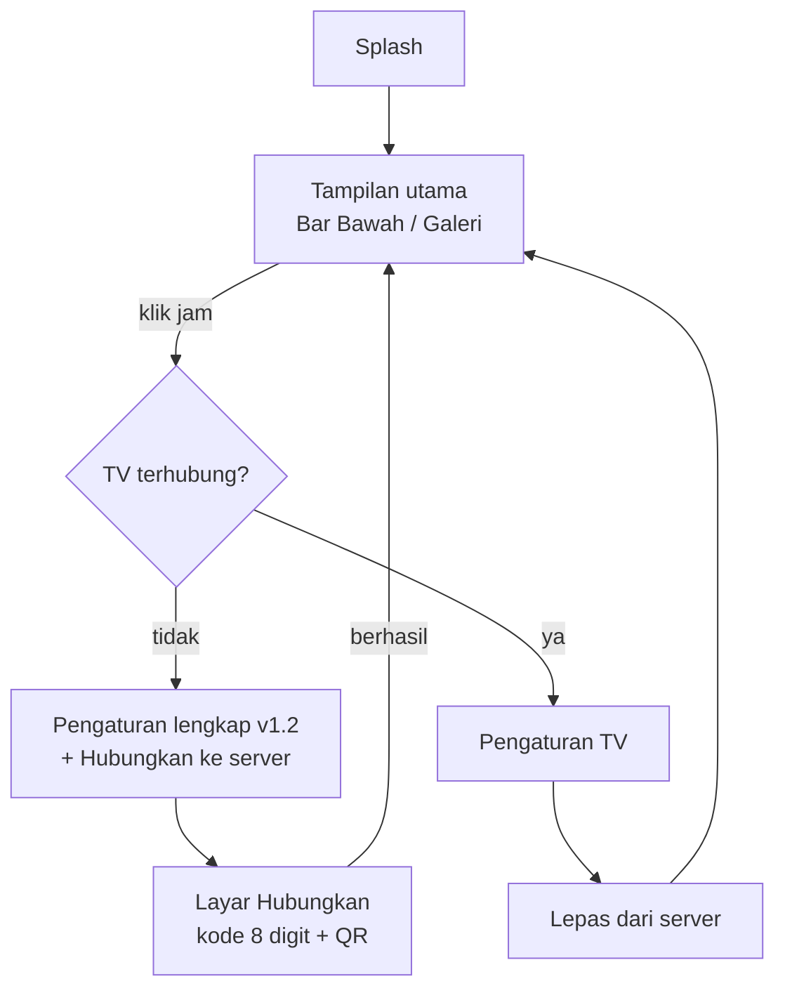
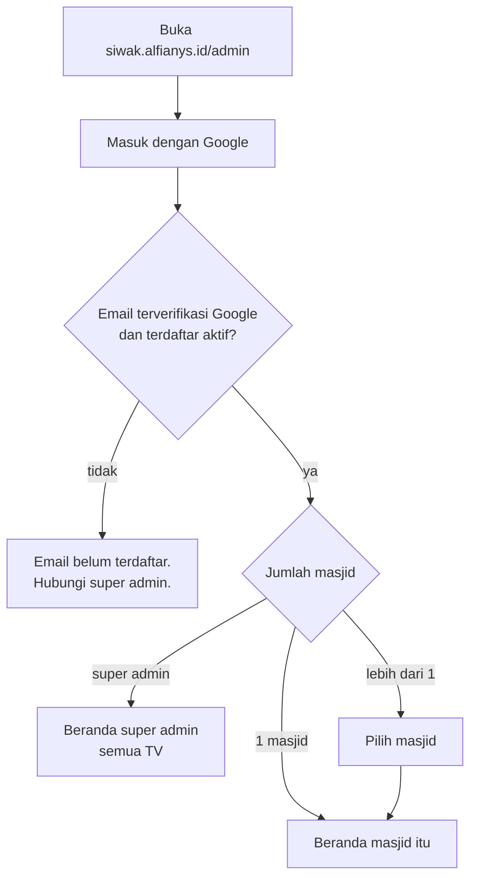
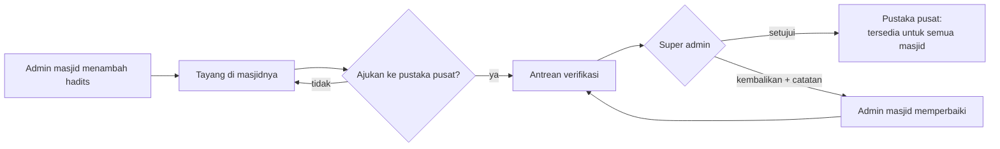

# 03 · App Flow · SIWAK V2

| | |
|---|---|
| **Versi dokumen** | 1.1 · 2026-11-16 |
| **Mengacu pada** | [01-PRD](01-PRD.md) · [02-TRD](02-TRD.md) |

Dokumen ini menjelaskan layar apa saja yang ada, urutan pengguna berpindah di antaranya, dan aturan
layar mana yang tampil di TV pada suatu waktu.

---

## 1. Peta layar

### 1.1 Aplikasi TV



| Layar | Ada di |
|---|---|
| Splash | v1.2 |
| Tampilan utama: Bar Bawah | v1.2 |
| Tampilan utama: Galeri | **baru** |
| Hitung mundur adzan layar penuh | v1.2 |
| Hitung mundur iqamah | v1.2 |
| Layar masuk waktu shalat (silent HP) | v1.2 |
| Layar Jumat | v1.2 |
| Mutiara Hadits | **baru** |
| Banner pengumuman (lapisan atas) | **baru** |
| Mode istirahat malam (lapisan redup) | v1.2 |
| Pengaturan lengkap (mode mandiri) | v1.2 + tombol "Hubungkan ke server" |
| Layar Hubungkan | **baru** |
| Pengaturan terbatas (TV terhubung) | **baru** |

### 1.2 Admin web

```
/admin/login
/admin                          Beranda: masjid Anda (super admin: ringkasan + semua masjid)
/admin/semua-tv                 Dasbor semua TV yang boleh Anda lihat (super admin: semua masjid)
/admin/m/{masjid}               Daftar TV · status · perintah · riwayat kejadian · Lepas
/admin/m/{masjid}/hubungkan     Hubungkan TV (admin)
/admin/m/{masjid}/pengumuman    Pengumuman segera
/admin/m/{masjid}/teks          Teks berjalan
/admin/m/{masjid}/konten        Slide · Panel informasi
/admin/m/{masjid}/pratinjau     Pratinjau layar TV
/admin/m/{masjid}/hadits        Hadits milik masjid (admin)
/admin/m/{masjid}/jadwal        Lokasi & jadwal · Adzan & iqamah (admin)
/admin/m/{masjid}/suara         (admin)
/admin/m/{masjid}/tampilan      (admin)
/admin/m/{masjid}/log           Log aktivitas masjid (admin)
--- khusus super admin ---
/admin/masjid                   Kelola masjid
/admin/pengguna                 Email, peran, masjid
/admin/pustaka                  Pustaka pusat & antrean verifikasi hadits
/admin/log                      Log aktivitas seluruh server
```

Pengguna yang mengelola lebih dari satu masjid punya **pemilih masjid** di bagian atas.
Menu yang tidak sesuai peran tidak ditampilkan, dan tetap ditolak server bila diakses langsung.

---

## 2. Alur aplikasi TV

### 2.1 Pertama kali dipasang

1. TV menyala → Splash → **tampilan utama dalam mode mandiri** (sama seperti v1.2).
2. Pengurus bisa langsung memakai TV tanpa server, atau menghubungkannya (§2.2).
3. Pengguna lama yang memperbarui dari v1.x tetap di mode mandiri dengan pengaturan lamanya.

### 2.2 Menghubungkan TV

1. Klik jam → Pengaturan → **Hubungkan ke server**.
2. Layar Hubungkan menampilkan:
   - kode 8 digit dalam huruf besar, dipisah `1234 5678` agar mudah dibaca;
   - QR berisi kode yang sama;
   - alamat server tujuan (`siwak.alfianys.id`) dan sisa waktu berlaku;
   - petunjuk: "Buka siwak.alfianys.id/admin di HP, masuk, pilih Hubungkan TV".
3. Saat kode kedaluwarsa (10 menit), kode baru dibuat otomatis.
4. Setelah pengurus memasukkan kode di admin web (§4.3), TV menampilkan "Terhubung ke
   *Masjid Al-Hidayah* sebagai *TV Serambi*", mengunduh data, lalu kembali ke tampilan utama.
5. Bila internet putus di tengah proses, layar menampilkan "Tidak bisa menghubungi server" dan
   tombol "Coba lagi". Tampilan utama tetap bisa dibuka dengan tombol Kembali.

### 2.3 TV terhubung, kondisi normal

- Tiap 60 detik heartbeat (TRD §7). Bila ada perubahan, data baru diterapkan tanpa restart.
- Pojok layar **tidak** menampilkan status koneksi, agar tampilan bersih. Status bisa dilihat di
  Pengaturan terbatas dan di admin web.

### 2.4 Membuka pengaturan di TV terhubung

Sejak v2.0.0-rc.3 tidak ada PIN. Klik jam → **Pengaturan TV**, dikelompokkan sama dengan menu admin web:

- **Koneksi**: masjid, nama TV, server, sinkron dan kontak terakhir, **Sinkron sekarang**;
- **Suara**: tes suara adzan dan iqamah;
- **Sistem**: izin aplikasi (overlay, abaikan pengoptimalan baterai, notifikasi, instal pembaruan),
  akses setelan Android, **Tentang** (versi, pengembang, kredit MosqueClock, atribusi OpenWeather,
  tautan legal, periksa dan pasang pembaruan), **Lepas dari server**.

Setelah berhasil terhubung, TV membuka daftar izin bila ada izin wajib yang belum diberikan; saat
dibuka berikutnya, dialog pengingat tampil selama masih ada yang kurang.

Pengaturan mode mandiri memakai urutan kelompok yang sama: Koneksi, Identitas masjid, Jadwal (sumber,
koreksi menit, Hijriah, adzan & iqamah, Jumat), Suara, Tampilan (logo & latar, warna & bahasa, jam,
mode malam, cuaca), Konten (teks berjalan), Sistem (izin, setelan Android, data, tentang & pembaruan).

### 2.4a Pertama kali dipasang

Pemasangan baru (bukan pembaruan) menampilkan layar sambutan: **Hubungkan ke server** atau **Mode
mandiri**. Bila tidak ada yang memilih dalam 90 detik, TV lanjut ke mode mandiri agar jam tetap tampil.
Izin "Tampil di atas aplikasi lain" tidak diminta saat aplikasi dibuka; TV yang terhubung mendapat
penjelasan dulu, lalu tombol menuju layar izin Android. Setelah terhubung, TV menampilkan
"Terhubung ke Masjid … sebagai TV …". Bila server tidak terjangkau lebih dari 5 menit, penanda kecil
muncul di sudut layar ("memakai data terakhir").

### 2.5 Lepas dari server

- Dari TV: Pengaturan terbatas → Lepas dari server → konfirmasi → TV memanggil `unpair`
  (atau langsung lepas bila offline) → kembali ke mode mandiri dengan **pengaturan terakhir dari server**.
- Dari web (§4.10): TV mengetahuinya pada heartbeat berikutnya (respons 401) → mode mandiri.

### 2.6 Internet putus

- TV tetap berjalan dengan data tersimpan (jadwal 7 hari, konten, cuaca terakhir).
- Pengumuman yang masa tayangnya habis tetap disembunyikan memakai jam TV.
- Saat internet kembali, heartbeat berikutnya mengejar semua perubahan.

---

## 3. Aturan layar di TV

### 3.1 Prioritas

`ScreenPriorityResolver` dievaluasi tiap detik. Layar dengan prioritas tertinggi yang syaratnya
terpenuhi yang tampil.

| Prioritas | Layar | Syarat |
|---|---|---|
| 1 | **Layar Jumat** | Hari Jumat, sejak adzan Dzuhur selama durasi Jumat, dan layar Jumat aktif |
| 2 | **Layar masuk waktu shalat** | Sejak iqamah selama durasi yang diatur |
| 3 | **Hitung mundur iqamah** | Antara adzan dan iqamah |
| 4 | **Hitung mundur adzan** layar penuh | N menit sebelum adzan (N diatur) |
| 5 | **Mutiara Hadits** | Jadwal berkala jatuh tempo, aktif, bukan mode malam, dan tidak ada layar prioritas 1–4 dalam 2 menit ke depan |
| 6 | **Tampilan utama** | Selalu, bila tidak ada yang di atas |

### 3.2 Lapisan di atas layar

| Lapisan | Tampil di atas prioritas | Tidak tampil di |
|---|---|---|
| **Banner pengumuman** | 4, 5, 6 | 1, 2, 3 (saat shalat dan khutbah) |
| **Mode istirahat malam** (redup) | 6 | 1–5; layar kembali terang otomatis saat ada hitung mundur |

Bila ada lebih dari satu pengumuman aktif, ditampilkan bergantian tiap 10 detik.

### 3.3 Panel slide di tata letak Galeri

Daftar putar dibentuk ulang setiap ada bundle baru, dari:

1. **Slide** milik masjid yang aktif dan jadwal tayangnya cocok (hari dan jam).
2. **Panel informasi** yang aktif (kas, petugas Jumat, agenda, hari besar).
3. **Hadits otomatis** dari kategori yang dipilih masjid (hadits masjid + pustaka pusat terverifikasi).

Aturan putar:

- Durasi bawaan 20 detik per slide, bisa diubah per slide (10–60 detik).
- Urutan: sesuai urutan yang diatur; hadits otomatis disisipkan setiap 2 slide.
- Panel **Petugas Jumat** diprioritaskan pada Kamis sore sampai Jumat siang.
- Daftar kosong → panel menampilkan ilustrasi periode saat ini dengan nama masjid.
- Transisi: pudar silang 800 ms.
- Panel slide berhenti (tidak berganti) selama prioritas 1–4 aktif.

### 3.4 Periode ilustrasi

| Periode | Dari | Sampai |
|---|---|---|
| Fajar | Subuh | Terbit |
| Siang | Terbit | 30 menit sebelum Maghrib |
| Senja | 30 menit sebelum Maghrib | Isya |
| Malam | Isya | Subuh |

Bentuk bulan di periode Malam dihitung dari tanggal Hijriah hari itu (setelah penyesuaian ± hari).

---

## 4. Alur admin web

### 4.1 Masuk



### 4.2 Beranda masjid

Menu masjid dikelompokkan: **Beranda**, **Konten** (Pengumuman, Teks berjalan, Slide & info, Hadits),
**Pengaturan** (Jadwal, Suara, Tampilan, Log; khusus admin), dan **Pratinjau**.

Isi beranda, dari atas: masalah yang perlu perhatian beserta tombol perbaikannya (mis. "Slide tidak
tampil karena tata letak Bar bawah → Pakai tata letak Galeri"), **Langkah awal** (hubungkan TV, periksa
jadwal, teks berjalan, slide), **Yang tampil di TV sekarang** (tata letak, pengumuman, teks, slide,
Mutiara Hadits dengan tombol **Tampilkan sekarang**), lalu daftar TV.

Setelah menyimpan perubahan apa pun, bagian atas halaman menampilkan status penerapan per TV:
menunggu TV → "Perubahan sudah berjalan di TV Serambi (09.12)", atau offline/gagal beserta alasannya.

### 4.3 Hubungkan TV

1. Menu TV → **Hubungkan TV**.
2. Ketik 8 digit, **atau** tekan **Scan QR** → izin kamera → arahkan ke QR di TV → kode terisi.
3. Pilih masjid (bila punya lebih dari satu) dan beri nama TV, mis. "Serambi".
4. Tekan **Hubungkan** → "TV Serambi terhubung" → TV muncul di daftar dan menampilkan daftar izin aplikasi.
5. Kode salah atau kedaluwarsa → "Kode tidak ditemukan atau sudah kedaluwarsa. Periksa angka di layar TV."

### 4.4 Mengubah pengaturan

1. Buka halaman (Jadwal, Suara, atau Tampilan) → ubah isian.
2. Tombol **Pratinjau** menampilkan simulasi layar TV dengan pengaturan baru.
3. **Simpan** → "Tersimpan. TV akan diperbarui dalam 1 menit." → versi data naik, tercatat di log.
4. Meninggalkan halaman dengan perubahan belum disimpan → konfirmasi di halaman itu sendiri.

### 4.5 Teks berjalan

Daftar pesan dengan sakelar aktif, urutan (tombol naik/turun), serta tanggal mulai dan selesai
(opsional). Pesan yang tanggal selesainya lewat otomatis berhenti tampil dan diberi label "Selesai".

### 4.6 Slide dan panel informasi

- **Tambah slide**: pilih dari pustaka (hadits, ilustrasi) atau unggah gambar, atur durasi dan jadwal.
- **Panel informasi**: formulir khusus per jenis:
  - Kas: tanggal laporan, saldo awal, pemasukan, pengeluaran (saldo akhir dihitung otomatis);
  - Petugas Jumat: tanggal, khatib, imam, muadzin, tema;
  - Agenda: daftar kegiatan (hari, jam, judul, pemateri);
  - Hari besar: pilih dari daftar hari besar Islam; sisa hari dihitung otomatis di TV.

### 4.7 Pengumuman segera

Isi (≤ 200 karakter) → sasaran (semua TV / TV tertentu) → masa tayang (30 menit, 1 jam, 2 jam,
hari ini, atau pilih sendiri) → **Kirim**. Daftar pengumuman aktif bisa **dicabut** sebelum waktunya.

### 4.8 Hadits



Formulir hadits: kategori, teks Arab (opsional), terjemah, sumber (mis. "HR. Muslim"),
catatan derajat (opsional).

### 4.9 PIN TV (dihapus di rc.3)

Pengaturan di TV terhubung tidak lagi dikunci PIN, sehingga menu PIN di admin web juga dihapus. Kode
8 angka untuk menghubungkan TV tetap dipakai.

### 4.10 Lepas TV

Menu TV → baris TV → **Lepas** → konfirmasi "TV akan kembali ke mode mandiri" → kunci perangkat dicabut.

### 4.10a Memantau dan membuka SIWAK dari jauh

Menu TV menampilkan setiap TV dengan titik warna **dan** teks:

- **Online · SIWAK tampil** (hijau).
- **Online · SIWAK di latar belakang sejak 09:12** (kuning) → tombol **Buka SIWAK** ditonjolkan.
- **Offline sejak 09:12** (merah) → "TV mati, internet putus, atau aplikasi dihentikan. Perintah tidak bisa dikirim."

Baris TV → **Buka SIWAK** / **Sinkron sekarang** / **Mulai ulang SIWAK** → status perintah tampil di
bawah tombol: "Menunggu TV (≤ 1 menit)" → "Diterima TV" → "Berhasil" atau "Gagal: …" (pesan dari TV).
Bila TV belum memberi izin membuka dari latar belakang: "Di TV ini SIWAK belum boleh membuka diri
sendiri. Di TV: Setelan → Aplikasi → SIWAK → Tampil di atas aplikasi lain → Izinkan."

Halaman **Tampilan** memuat opsi **Selalu kembali ke SIWAK** setelah N menit (bawaan mati).

### 4.11 Pengguna (super admin)

Tambah: email Google, peran (super admin / admin / operator), masjid (untuk admin dan operator,
bisa lebih dari satu). Ubah peran, tambah/hapus masjid, nonaktifkan. Super admin tidak bisa
menonaktifkan dirinya sendiri, dan sistem selalu menyisakan minimal satu super admin aktif.

---

## 5. Pesan galat dan keadaan kosong

| Keadaan | Pesan |
|---|---|
| Email belum terdaftar | "Email ini belum terdaftar di SIWAK. Hubungi super admin untuk mendapatkan akses." |
| Kode TV salah/kedaluwarsa | "Kode tidak ditemukan atau sudah kedaluwarsa. Periksa angka di layar TV." |
| Kamera ditolak | "Izin kamera ditolak. Ketik kode 8 digit secara manual." |
| Unggahan terlalu besar | "Berkas lebih dari 5 MB. Perkecil gambar lalu coba lagi." |
| Belum ada TV | "Belum ada TV di masjid ini. Tekan Hubungkan TV untuk memulai." |
| Belum ada teks berjalan | "Belum ada teks berjalan. Tambahkan pesan pertama." |
| TV offline | Label merah "Offline sejak 09:12" di daftar TV |
| Jam TV meleset | Label kuning "Jam TV selisih 3 menit. Periksa pengaturan waktu TV." |
| Server tidak terjangkau (di TV) | "Tidak bisa menghubungi server. Tampilan tetap berjalan dengan data terakhir." |
