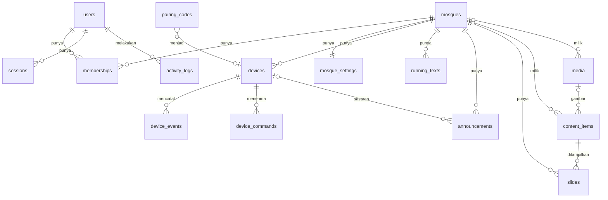

# 05 · Backend Schema · SIWAK V2

| | |
|---|---|
| **Versi dokumen** | 1.2 · 2026-11-16 (MariaDB; pemantauan & perintah jarak jauh) |
| **Mengacu pada** | [02-TRD](02-TRD.md) |
| **Sumber kebenaran di kode** | `siwak-server/api/src/db/schema.ts` (Drizzle). Bila berbeda, perbarui dokumen ini di commit yang sama. |

Isi: struktur database server, format data yang dikirim ke TV, pemetaan pengaturan ke aplikasi TV,
dan tabel lokal di TV.

---

## 1. Konvensi

- **MariaDB 10.11** (versi di VPS), mesin InnoDB, `utf8mb4` dengan kolasi `utf8mb4_unicode_ci`.
  Kolasi `_ci` membuat perbandingan email tidak peka huruf besar/kecil.
- Nama tabel dan kolom `snake_case`, tabel jamak.
- ID memakai UUID bentuk teks `CHAR(36)` yang dibuat aplikasi (`crypto.randomUUID()`), kecuali tabel
  log yang memakai `BIGINT AUTO_INCREMENT`.
- Semua waktu `DATETIME(3)` dalam **UTC**. Koneksi aplikasi menetapkan `time_zone = '+00:00'`.
  Jam tampil (mis. `starts_on`, `time_from`) dalam zona waktu masjid (`mosques.timezone`).
- Data JSON memakai tipe `JSON` (di MariaDB berupa `LONGTEXT` dengan pemeriksaan `JSON_VALID`).
  Isinya divalidasi Zod di aplikasi.
- Hash SHA-256 disimpan sebagai teks heksadesimal `CHAR(64)`; data terenkripsi sebagai base64
  `VARCHAR`. Alamat IP memakai `VARCHAR(45)` (cukup untuk IPv6).
- Penghapusan masjid memakai `archived_at` (arsip), bukan hapus permanen.
- Setiap perubahan data milik masjid menaikkan `mosques.config_version` **di transaksi yang sama**.
  Perubahan pustaka pusat yang terverifikasi menaikkan `app_state.content_version`.
- Migrasi dibuat dengan drizzle-kit (dialek `mysql`, driver `mysql2`) dan disimpan di repo.

## 2. Diagram relasi



## 3. Tabel

Setiap `CREATE TABLE` di bawah memakai
`ENGINE=InnoDB DEFAULT CHARSET=utf8mb4 COLLATE=utf8mb4_unicode_ci` (tidak ditulis ulang agar ringkas).

```sql
-- 3.1 Pengguna & akses ------------------------------------------------------

CREATE TABLE users (
  id              CHAR(36)      NOT NULL PRIMARY KEY,
  email           VARCHAR(254)  NOT NULL,
  google_sub      VARCHAR(64)   NULL,                -- diisi saat login pertama
  name            VARCHAR(120)  NULL,
  avatar_url      VARCHAR(500)  NULL,
  is_super_admin  BOOLEAN       NOT NULL DEFAULT FALSE,
  status          ENUM('active','disabled') NOT NULL DEFAULT 'active',
  last_login_at   DATETIME(3)   NULL,
  created_at      DATETIME(3)   NOT NULL DEFAULT CURRENT_TIMESTAMP(3),
  created_by      CHAR(36)      NULL,
  UNIQUE KEY uq_users_email (email),
  UNIQUE KEY uq_users_google_sub (google_sub),
  CONSTRAINT fk_users_created_by FOREIGN KEY (created_by) REFERENCES users(id) ON DELETE SET NULL
);

CREATE TABLE mosques (
  id              CHAR(36)      NOT NULL PRIMARY KEY,
  name            VARCHAR(120)  NOT NULL,
  slug            VARCHAR(80)   NOT NULL,
  region_label    VARCHAR(120)  NULL,                -- mis. "Kab. Sleman"
  latitude        DECIMAL(9,6)  NOT NULL,
  longitude       DECIMAL(9,6)  NOT NULL,
  timezone        VARCHAR(40)   NOT NULL DEFAULT 'Asia/Jakarta',
  config_version  INT UNSIGNED  NOT NULL DEFAULT 1,
  created_at      DATETIME(3)   NOT NULL DEFAULT CURRENT_TIMESTAMP(3),
  archived_at     DATETIME(3)   NULL,
  UNIQUE KEY uq_mosques_slug (slug)
);

CREATE TABLE memberships (
  user_id    CHAR(36) NOT NULL,
  mosque_id  CHAR(36) NOT NULL,
  role       ENUM('admin','operator') NOT NULL,
  created_at DATETIME(3) NOT NULL DEFAULT CURRENT_TIMESTAMP(3),
  PRIMARY KEY (user_id, mosque_id),
  CONSTRAINT fk_mem_user   FOREIGN KEY (user_id)   REFERENCES users(id)   ON DELETE CASCADE,
  CONSTRAINT fk_mem_mosque FOREIGN KEY (mosque_id) REFERENCES mosques(id) ON DELETE CASCADE
);

CREATE TABLE sessions (
  id            CHAR(43)     NOT NULL PRIMARY KEY,   -- 32 byte acak, base64url
  user_id       CHAR(36)     NOT NULL,
  csrf_token    CHAR(43)     NOT NULL,
  created_at    DATETIME(3)  NOT NULL DEFAULT CURRENT_TIMESTAMP(3),
  last_seen_at  DATETIME(3)  NOT NULL DEFAULT CURRENT_TIMESTAMP(3),
  expires_at    DATETIME(3)  NOT NULL,
  user_agent    VARCHAR(300) NULL,
  ip            VARCHAR(45)  NULL,
  KEY ix_sessions_user (user_id),
  KEY ix_sessions_expires (expires_at),
  CONSTRAINT fk_sessions_user FOREIGN KEY (user_id) REFERENCES users(id) ON DELETE CASCADE
);

-- 3.2 Pengaturan masjid ---------------------------------------------------------

CREATE TABLE mosque_settings (
  mosque_id       CHAR(36)          NOT NULL PRIMARY KEY,
  schema_version  SMALLINT UNSIGNED NOT NULL DEFAULT 1,
  data            JSON              NOT NULL,         -- lihat §4, divalidasi Zod
  updated_at      DATETIME(3)       NOT NULL DEFAULT CURRENT_TIMESTAMP(3),
  updated_by      CHAR(36)          NULL,
  CONSTRAINT fk_settings_mosque FOREIGN KEY (mosque_id)  REFERENCES mosques(id) ON DELETE CASCADE,
  CONSTRAINT fk_settings_user   FOREIGN KEY (updated_by) REFERENCES users(id) ON DELETE SET NULL
);

-- 3.3 Perangkat TV ---------------------------------------------------------------

CREATE TABLE devices (
  id                    CHAR(36)       NOT NULL PRIMARY KEY,
  mosque_id             CHAR(36)       NOT NULL,
  name                  VARCHAR(60)    NOT NULL,
  token_hash            CHAR(64)       NULL,          -- SHA-256 kunci perangkat (hex); NULL = dicabut
  pin_ciphertext        VARCHAR(128)   NOT NULL,      -- AES-256-GCM base64: iv(12) + tag(16) + data
  pin_salt              CHAR(32)       NOT NULL,      -- 16 byte, hex
  pin_hash              CHAR(64)       NOT NULL,      -- SHA-256(pin_salt || pin) hex, dikirim ke TV
  pin_updated_at        DATETIME(3)    NOT NULL DEFAULT CURRENT_TIMESTAMP(3),
  app_version           VARCHAR(20)    NULL,
  model                 VARCHAR(80)    NULL,
  last_seen_at          DATETIME(3)    NULL,
  last_config_version   INT UNSIGNED   NULL,
  last_content_version  INT UNSIGNED   NULL,
  clock_drift_sec       INT            NULL,
  is_online             BOOLEAN        NOT NULL DEFAULT FALSE,
  app_foreground        BOOLEAN        NULL,      -- SIWAK sedang tampil di layar (laporan heartbeat)
  app_state_since       DATETIME(3)    NULL,      -- sejak kapan keadaan app_foreground berlaku
  can_open_app          BOOLEAN        NULL,      -- TV boleh membuka SIWAK dari latar belakang
  paired_at             DATETIME(3)    NOT NULL DEFAULT CURRENT_TIMESTAMP(3),
  paired_by             CHAR(36)       NULL,
  revoked_at            DATETIME(3)    NULL,
  UNIQUE KEY uq_devices_token (token_hash),
  KEY ix_devices_mosque (mosque_id),
  KEY ix_devices_seen (last_seen_at),
  CONSTRAINT fk_devices_mosque FOREIGN KEY (mosque_id) REFERENCES mosques(id),
  CONSTRAINT fk_devices_user   FOREIGN KEY (paired_by) REFERENCES users(id) ON DELETE SET NULL
);

CREATE TABLE pairing_codes (
  id                  CHAR(36)     NOT NULL PRIMARY KEY,
  code                CHAR(8)      NOT NULL,
  nonce_hash          CHAR(64)     NOT NULL,          -- SHA-256 nonce dari TV (hex)
  app_version         VARCHAR(20)  NULL,
  model               VARCHAR(80)  NULL,
  expires_at          DATETIME(3)  NOT NULL,          -- dibuat + 10 menit
  claimed_at          DATETIME(3)  NULL,
  claimed_by          CHAR(36)     NULL,
  device_id           CHAR(36)     NULL,
  token_delivered_at  DATETIME(3)  NULL,              -- kunci dibuat & dikirim saat TV polling pertama sesudah klaim
  created_ip          VARCHAR(45)  NULL,
  created_at          DATETIME(3)  NOT NULL DEFAULT CURRENT_TIMESTAMP(3),
  -- Pengganti partial unique index: aplikasi mengisi active_code = code saat dibuat dan
  -- mengosongkannya (NULL) saat diklaim/kedaluwarsa. MariaDB menolak kolom GENERATED untuk ini.
  active_code         CHAR(8)      NULL,
  UNIQUE KEY uq_pairing_active_code (active_code),
  KEY ix_pairing_expires (expires_at),
  CONSTRAINT fk_pairing_user   FOREIGN KEY (claimed_by) REFERENCES users(id)   ON DELETE SET NULL,
  CONSTRAINT fk_pairing_device FOREIGN KEY (device_id)  REFERENCES devices(id) ON DELETE SET NULL
);

CREATE TABLE device_events (
  id         BIGINT UNSIGNED NOT NULL AUTO_INCREMENT PRIMARY KEY,
  device_id  CHAR(36)        NOT NULL,
  type       ENUM('paired','online','offline','clock_drift','error','updated','unpaired',
                  'app_foreground','app_background','command') NOT NULL,
  detail     JSON            NULL,
  at         DATETIME(3)     NOT NULL DEFAULT CURRENT_TIMESTAMP(3),
  KEY ix_device_events (device_id, at),
  CONSTRAINT fk_events_device FOREIGN KEY (device_id) REFERENCES devices(id) ON DELETE CASCADE
);

-- Perintah jarak jauh dari admin web ke TV (TRD §7.4)
CREATE TABLE device_commands (
  id           CHAR(36)     NOT NULL PRIMARY KEY,
  device_id    CHAR(36)     NOT NULL,
  type         ENUM('open_app','sync_now','restart_app') NOT NULL,
  status       ENUM('pending','delivered','done','failed','expired') NOT NULL DEFAULT 'pending',
  created_by   CHAR(36)     NULL,
  created_at   DATETIME(3)  NOT NULL DEFAULT CURRENT_TIMESTAMP(3),
  delivered_at DATETIME(3)  NULL,
  finished_at  DATETIME(3)  NULL,
  result       VARCHAR(200) NULL,
  KEY ix_cmd_device (device_id, status),
  KEY ix_cmd_created (created_at),
  CONSTRAINT fk_cmd_device FOREIGN KEY (device_id)  REFERENCES devices(id) ON DELETE CASCADE,
  CONSTRAINT fk_cmd_user   FOREIGN KEY (created_by) REFERENCES users(id)   ON DELETE SET NULL
);

-- 3.4 Konten -------------------------------------------------------------------

CREATE TABLE media (
  id             CHAR(36)          NOT NULL PRIMARY KEY,
  mosque_id      CHAR(36)          NULL,              -- NULL = milik pustaka pusat
  kind           ENUM('image','audio') NOT NULL,
  mime           VARCHAR(60)       NOT NULL,
  bytes          INT UNSIGNED      NOT NULL,
  sha256         CHAR(64)          NOT NULL,          -- hex; juga nama berkas di disk
  width          SMALLINT UNSIGNED NULL,
  height         SMALLINT UNSIGNED NULL,
  duration_ms    INT UNSIGNED      NULL,
  original_name  VARCHAR(200)      NULL,
  uploaded_by    CHAR(36)          NULL,
  created_at     DATETIME(3)       NOT NULL DEFAULT CURRENT_TIMESTAMP(3),
  KEY ix_media_sha (sha256),
  CONSTRAINT fk_media_mosque FOREIGN KEY (mosque_id)   REFERENCES mosques(id),
  CONSTRAINT fk_media_user   FOREIGN KEY (uploaded_by) REFERENCES users(id) ON DELETE SET NULL
);

CREATE TABLE content_items (
  id              CHAR(36)      NOT NULL PRIMARY KEY,
  scope           ENUM('global','mosque') NOT NULL,
  mosque_id       CHAR(36)      NULL,
  type            ENUM('hadith','info_kas','info_jumat','info_agenda','info_hari_besar','image') NOT NULL,
  category        VARCHAR(40)   NULL,                 -- kategori hadits, lihat §6
  arabic_text     TEXT          NULL,
  translation     VARCHAR(600)  NULL,
  source_ref      VARCHAR(120)  NULL,                 -- mis. "HR. Bukhari & Muslim"
  grade_note      VARCHAR(200)  NULL,
  body            JSON          NULL,                 -- isi panel informasi, lihat §5.3
  media_id        CHAR(36)      NULL,
  status          ENUM('draft','published','submitted','verified','rejected') NOT NULL,
  origin_item_id  CHAR(36)      NULL,                 -- salinan pustaka pusat dari hadits masjid
  review_note     VARCHAR(500)  NULL,
  reviewed_by     CHAR(36)      NULL,
  reviewed_at     DATETIME(3)   NULL,
  created_by      CHAR(36)      NULL,
  created_at      DATETIME(3)   NOT NULL DEFAULT CURRENT_TIMESTAMP(3),
  updated_at      DATETIME(3)   NOT NULL DEFAULT CURRENT_TIMESTAMP(3) ON UPDATE CURRENT_TIMESTAMP(3),
  KEY ix_content_scope_status (scope, status),
  KEY ix_content_mosque_type (mosque_id, type),
  CONSTRAINT ck_content_scope CHECK (
    (scope = 'global' AND mosque_id IS NULL AND status IN ('draft','submitted','verified','rejected'))
    OR
    (scope = 'mosque' AND mosque_id IS NOT NULL AND status IN ('draft','published'))
  ),
  CONSTRAINT fk_content_mosque   FOREIGN KEY (mosque_id)      REFERENCES mosques(id),
  CONSTRAINT fk_content_media    FOREIGN KEY (media_id)       REFERENCES media(id) ON DELETE SET NULL,
  CONSTRAINT fk_content_origin   FOREIGN KEY (origin_item_id) REFERENCES content_items(id) ON DELETE SET NULL,
  CONSTRAINT fk_content_reviewer FOREIGN KEY (reviewed_by)    REFERENCES users(id) ON DELETE SET NULL,
  CONSTRAINT fk_content_creator  FOREIGN KEY (created_by)     REFERENCES users(id) ON DELETE SET NULL
);

CREATE TABLE slides (
  id               CHAR(36)          NOT NULL PRIMARY KEY,
  mosque_id        CHAR(36)          NOT NULL,
  content_item_id  CHAR(36)          NOT NULL,
  duration_sec     TINYINT UNSIGNED  NOT NULL DEFAULT 20,
  sort_order       INT               NOT NULL DEFAULT 0,
  enabled          BOOLEAN           NOT NULL DEFAULT TRUE,
  days_mask        TINYINT UNSIGNED  NOT NULL DEFAULT 127,  -- bit 0 = Senin ... bit 6 = Minggu
  time_from        TIME              NULL,
  time_to          TIME              NULL,
  created_at       DATETIME(3)       NOT NULL DEFAULT CURRENT_TIMESTAMP(3),
  updated_at       DATETIME(3)       NOT NULL DEFAULT CURRENT_TIMESTAMP(3) ON UPDATE CURRENT_TIMESTAMP(3),
  CONSTRAINT ck_slides_duration CHECK (duration_sec BETWEEN 10 AND 60),
  CONSTRAINT fk_slides_mosque  FOREIGN KEY (mosque_id)       REFERENCES mosques(id) ON DELETE CASCADE,
  CONSTRAINT fk_slides_content FOREIGN KEY (content_item_id) REFERENCES content_items(id)
);

CREATE TABLE running_texts (
  id          CHAR(36)      NOT NULL PRIMARY KEY,
  mosque_id   CHAR(36)      NOT NULL,
  text        VARCHAR(300)  NOT NULL,
  sort_order  INT           NOT NULL DEFAULT 0,
  enabled     BOOLEAN       NOT NULL DEFAULT TRUE,
  starts_on   DATE          NULL,
  ends_on     DATE          NULL,
  updated_by  CHAR(36)      NULL,
  updated_at  DATETIME(3)   NOT NULL DEFAULT CURRENT_TIMESTAMP(3) ON UPDATE CURRENT_TIMESTAMP(3),
  KEY ix_rt_mosque (mosque_id, sort_order),
  CONSTRAINT fk_rt_mosque FOREIGN KEY (mosque_id)  REFERENCES mosques(id) ON DELETE CASCADE,
  CONSTRAINT fk_rt_user   FOREIGN KEY (updated_by) REFERENCES users(id) ON DELETE SET NULL
);

CREATE TABLE announcements (
  id          CHAR(36)      NOT NULL PRIMARY KEY,
  mosque_id   CHAR(36)      NOT NULL,
  device_id   CHAR(36)      NULL,                     -- NULL = semua TV masjid
  text        VARCHAR(200)  NOT NULL,
  starts_at   DATETIME(3)   NOT NULL DEFAULT CURRENT_TIMESTAMP(3),
  expires_at  DATETIME(3)   NOT NULL,
  revoked_at  DATETIME(3)   NULL,
  created_by  CHAR(36)      NULL,
  created_at  DATETIME(3)   NOT NULL DEFAULT CURRENT_TIMESTAMP(3),
  KEY ix_ann_mosque (mosque_id, expires_at),
  CONSTRAINT ck_ann_window CHECK (expires_at > starts_at),
  CONSTRAINT fk_ann_mosque FOREIGN KEY (mosque_id)  REFERENCES mosques(id) ON DELETE CASCADE,
  CONSTRAINT fk_ann_device FOREIGN KEY (device_id)  REFERENCES devices(id) ON DELETE CASCADE,
  CONSTRAINT fk_ann_user   FOREIGN KEY (created_by) REFERENCES users(id) ON DELETE SET NULL
);

-- 3.5 Lain-lain ---------------------------------------------------------------------

CREATE TABLE weather_cache (
  cell_key           VARCHAR(24)  NOT NULL PRIMARY KEY,   -- "-7.77,110.38"
  payload            JSON         NOT NULL,               -- lihat §5.4
  fetched_at         DATETIME(3)  NOT NULL,
  last_requested_at  DATETIME(3)  NOT NULL
);

CREATE TABLE app_state (
  id               TINYINT UNSIGNED NOT NULL PRIMARY KEY,
  content_version  INT UNSIGNED     NOT NULL DEFAULT 1,
  CONSTRAINT ck_app_state_single CHECK (id = 1)        -- tanpa awalan nama tabel (batasan MariaDB)
);

CREATE TABLE activity_logs (
  id         BIGINT UNSIGNED NOT NULL AUTO_INCREMENT PRIMARY KEY,
  user_id    CHAR(36)     NULL,
  mosque_id  CHAR(36)     NULL,
  action     VARCHAR(60)  NOT NULL,                 -- mis. "settings.update", "device.pin.reveal"
  entity     VARCHAR(40)  NULL,
  entity_id  VARCHAR(64)  NULL,
  diff       JSON         NULL,                     -- nilai lama dan baru
  ip         VARCHAR(45)  NULL,
  at         DATETIME(3)  NOT NULL DEFAULT CURRENT_TIMESTAMP(3),
  KEY ix_activity_mosque (mosque_id, at),
  CONSTRAINT fk_activity_user   FOREIGN KEY (user_id)   REFERENCES users(id)   ON DELETE SET NULL,
  CONSTRAINT fk_activity_mosque FOREIGN KEY (mosque_id) REFERENCES mosques(id) ON DELETE SET NULL
);
```

### 3.6 Retensi

| Data | Disimpan | Dijalankan oleh |
|---|---|---|
| `activity_logs` | 1 tahun | Pekerjaan retensi harian |
| `device_events` | 90 hari | Pekerjaan retensi harian |
| `device_commands` | 30 hari | Pekerjaan retensi harian |
| `sessions` kedaluwarsa | Dihapus | Pekerjaan retensi harian |
| `pairing_codes` | Kedaluwarsa > 1 hari dihapus | Pekerjaan kedaluwarsa |
| `announcements` | 90 hari setelah kedaluwarsa | Pekerjaan retensi harian |
| `media` tanpa rujukan | Diunggah > 30 hari lalu dan tidak dirujuk konten atau pengaturan mana pun: dihapus beserta berkasnya (berkas tetap disimpan bila masih dipakai catatan lain dengan isi sama) | Pekerjaan retensi harian |

## 4. Pengaturan masjid (`mosque_settings.data`, versi skema 1)

```json
{
  "schedule": {
    "source": "KEMENAG",
    "manualTimes": { "imsak": "04:20", "subuh": "04:30", "terbit": "05:45", "dzuhur": "11:45", "ashar": "15:00", "maghrib": "17:50", "isya": "19:00" },
    "offsetsEnabled": false,
    "offsets": { "imsak": 0, "subuh": 0, "terbit": 0, "dzuhur": 0, "ashar": 0, "maghrib": 0, "isya": 0 },
    "showImsak": false,
    "showTerbit": true,
    "hijri": { "source": "HISAB", "dayOffset": 0, "manual": null }
  },
  "prayerCycle": {
    "iqamahGapMinutes": { "subuh": 20, "dzuhur": 10, "ashar": 10, "maghrib": 10, "isya": 10 },
    "showIqamahCycle": true,
    "fullScreenCountdown": { "enabled": true, "minutes": 10 },
    "prayerScreenMinutes": 5,
    "jumat": { "screenEnabled": true, "durationMinutes": 60 },
    "jumatNightBayan": { "enabled": false, "minutes": 30 }
  },
  "sound": {
    "enabled": true,
    "adzan":  { "enabled": true, "type": "BEEP", "mediaId": null },
    "iqamah": { "enabled": true, "type": "BEEP", "mediaId": null }
  },
  "display": {
    "layout": "GALERI",
    "colorTheme": "classic_mosque",
    "language": "id",
    "clock": { "type": "DIGITAL", "showSeconds": true, "use24h": true, "sizePercent": 100 },
    "nightMode": { "enabled": false, "startHour": 22, "endHour": 4, "dimPercent": 85 },
    "media": { "logoId": null, "backgroundMainId": null, "backgroundPrayerId": null, "backgroundIqamahId": null },
    "showWeather": true,
    "illustration": { "silhouette": "KUBAH", "useMosquePhoto": false },
    "content": { "enabled": true, "slideSeconds": 20 },
    "mutiaraHadits": { "enabled": true, "everyMinutes": 5, "showSeconds": 20 },
    "hadithCategories": ["adab_masjid", "shaf_berjamaah", "keutamaan", "jumat"]
  },
  "kiosk": {
    "autoReturn": { "enabled": false, "minutes": 10 }
  }
}
```

Batas nilai (divalidasi Zod di server dan diperiksa ulang di TV):

| Field | Nilai sah |
|---|---|
| `schedule.source` | `KEMENAG`, `MANUAL` |
| `offsets.*` | −15 … 15 (menit) |
| `hijri.source` | `HISAB`, `MANUAL`; `dayOffset` −2 … 2; `manual` = `{ day, month, year, setOn }` |
| `iqamahGapMinutes.*` | 0 … 60 |
| `fullScreenCountdown.minutes` | 1 … 30 |
| `prayerScreenMinutes` | 1 … 15 |
| `jumat.durationMinutes` | 30 … 120 |
| `sound.*.type` | `BEEP`, `TICK`, `CUSTOM` (`mediaId` wajib bila `CUSTOM`) |
| `display.layout` | `BAR_BAWAH`, `GALERI` |
| `clock.type` | `DIGITAL`, `ANALOG`; `sizePercent` 100, 115, 130 |
| `nightMode` | jam 0 … 23; `dimPercent` 0 … 100 |
| `illustration.silhouette` | `KUBAH`, `TUMPANG`, `MUSHOLLA` |
| `content.slideSeconds` | 10 … 60 (lama hadits otomatis di panel samping) |
| `mutiaraHadits.everyMinutes` | 1 … 60; `showSeconds` 10 … 120 (layar penuh berkala) |
| `kiosk.autoReturn.minutes` | 1 … 120 |

### 4.1 Pemetaan ke `AppSettings` aplikasi TV

| Field server | Field `AppSettings` (v1.3) |
|---|---|
| `mosques.name` | `mosqueName` |
| `mosques.latitude` / `longitude` / `region_label` | `latitude` / `longitude` / `city` |
| `schedule.source` | `prayerServiceType` (`KEMENAG` → `AL_ADHAN_API`, `MANUAL` → `MANUAL`) |
| `schedule.manualTimes.*` | `manualImsak`, `manualFajrAzan`, `manualSunrise`, `manualDhuhrAzan`, `manualAsrAzan`, `manualMaghribAzan`, `manualIshaAzan` |
| `schedule.offsetsEnabled` / `offsets.*` | `prayerOffsetEnabled` / `imsakOffset`, `fajrOffset`, `sunriseOffset`, `dhuhrOffset`, `asrOffset`, `maghribOffset`, `ishaOffset` |
| `schedule.showImsak` / `showTerbit` | `showImsak` / `showSunrise` |
| `schedule.hijri` | `hijriProvider`, `hijriDayOffset`, `manualHijriDay/Month/Year`, `lastUpdatedGregorianDate` |
| `prayerCycle.iqamahGapMinutes.*` | `fajrIqamahGap`, `dhuhrIqamahGap`, `asrIqamahGap`, `maghribIqamahGap`, `ishaIqamahGap` |
| `prayerCycle.showIqamahCycle` | `showIqamahCycle` |
| `prayerCycle.fullScreenCountdown` | `fullScreenCountdownEnabled`, `fullScreenCountdownMinutes` |
| `prayerCycle.prayerScreenMinutes` | `duaDisplayDurationMinutes` |
| `prayerCycle.jumat` | `showJummahScreen`, `jummahDurationMinutes` |
| `prayerCycle.jumatNightBayan` | `jummaNightBayanEnabled`, `jummaNightBayanMinutes` |
| `sound.enabled` | `soundEnabled` |
| `sound.adzan` / `sound.iqamah` | `azanSoundEnabled`, `azanSoundType`, `azanSoundUri` / `iqamah…` (`BEEP` → `TRADITIONAL_BEEP`, `TICK` → `COUNTDOWN_TICKING`; `mediaId` → URI berkas lokal hasil unduhan) |
| `display.colorTheme` | `colorTheme` |
| `display.language` | `language` |
| `display.clock` | `clockType`, `showSeconds`, `show24HourFormat`, `clockSizePercent` |
| `display.nightMode` | `nightModeEnabled`, `nightStartHour`, `nightEndHour`, `nightDimLevel` |
| `display.media.*` | `mosqueLogoUri`, `backgroundMainUri`, `backgroundPrayerUri`, `backgroundIqamahUri` |
| `display.showWeather` | `showWeather` |
| daftar `running_texts` | `runningTextMessages` (digabung dengan pemisah `||`) |
| `display.layout`, `illustration`, `mutiaraHadits`, `hadithCategories` | Field baru di v2 |
| `display.content` | Field baru di rc.3; dokumen lama tanpa field ini dianggap menyala bila Galeri atau layar penuh aktif |
| `kiosk.autoReturn` | Field baru di v2 (disimpan di `ServerStore`, dipakai layanan latar) |

Field `AppSettings` yang **tidak** disinkron (lokal atau usang): `theme`, `fontSize`, `refreshInterval`,
`weatherCity`, `weatherCountry`, `weatherProvider`, `weatherApiKey`, `openWeatherMapApiKey`,
`mosqueClockBackendUrl`, `mosqueClockBackendApiKey`, `selectedZone`, `selectedRegion`,
`prayerLastSyncMillis`, `weatherLastSyncMillis`, `cachedWeatherJson`, `autoUpdateCheckEnabled`,
`skippedUpdateVersion`. Bawaan `openWeatherMapApiKey` dihapus dari kode saat rilis 2.0 (tugas R.3).

## 5. Format data untuk TV

### 5.1 Bundle (`GET /api/v1/device/bundle`)

```json
{
  "bundleSchema": 1,
  "generatedAt": "2026-10-20T04:31:05Z",
  "configVersion": 42,
  "contentVersion": 12,
  "mosque": { "id": "…", "name": "Masjid Al-Hidayah", "regionLabel": "Kab. Sleman", "latitude": -7.7712, "longitude": 110.3874, "timezone": "Asia/Jakarta" },
  "device": { "id": "…", "name": "Serambi", "pinSalt": "hex…", "pinHash": "hex…" },
  "settings": { "…": "lihat §4" },
  "runningTexts": [ { "id": "…", "text": "Kajian rutin Selasa ba'da Maghrib", "startsOn": null, "endsOn": null } ],
  "slides": [ { "id": "…", "contentId": "…", "durationSec": 20, "daysMask": 127, "timeFrom": null, "timeTo": null } ],
  "content": [ { "id": "…", "type": "hadith", "category": "shaf_berjamaah", "arabicText": "…", "translation": "…", "sourceRef": "HR. Bukhari & Muslim", "body": null, "mediaId": null } ],
  "announcements": [ { "id": "…", "text": "…", "startsAt": "…", "expiresAt": "…" } ],
  "media": [ { "id": "…", "kind": "image", "mime": "image/webp", "sha256": "hex…", "bytes": 182044 } ]
}
```

- `runningTexts`: hanya yang aktif, sudah diurutkan.
- `content`: semua konten yang dirujuk slide, ditambah kumpulan hadits untuk `hadithCategories`
  (hadits masjid berstatus `published` dan pustaka pusat berstatus `verified`), maks. 200 entri.
- `announcements`: yang belum kedaluwarsa dan belum dicabut, untuk TV ini atau semua TV.
- `media`: semua media yang dirujuk pengaturan dan konten.

### 5.2 Heartbeat

Lihat TRD §7.1.

### 5.3 Isi `content_items.body` per jenis panel

```json
{ "type": "info_kas", "reportDate": "2026-10-17", "openingBalance": 12450000, "income": 2315000, "expense": 980000 }
{ "type": "info_jumat", "date": "2026-10-23", "khatib": "…", "imam": "…", "muadzin": "…", "theme": "…" }
{ "type": "info_agenda", "items": [ { "day": "Selasa", "time": "18:15", "title": "Kajian Bulughul Maram", "speaker": "…" } ] }
{ "type": "info_hari_besar", "event": "ISRA_MIRAJ" }
```

- Nilai uang dalam rupiah (bilangan bulat). Saldo akhir dihitung di TV: `openingBalance + income − expense`.
- `info_hari_besar.event`: `TAHUN_BARU_HIJRIAH`, `ASYURA`, `MAULID_NABI`, `ISRA_MIRAJ`, `AWAL_RAMADAN`,
  `NUZULUL_QURAN`, `IDUL_FITRI`, `IDUL_ADHA`, `ARAFAH`. Tanggal Hijriah tiap acara tetap; sisa hari
  dihitung di TV dari tanggal Hijriah (setelah penyesuaian ± hari).

### 5.4 Cuaca (`GET /api/v1/device/weather`)

```json
{ "cellKey": "-7.77,110.39", "fetchedAt": "2026-10-20T04:30:00Z", "temperatureC": 31.2, "feelsLikeC": 34.0, "humidity": 64, "windKmh": 9.4, "iconCode": "02d", "description": "sedikit berawan",
  "observedAt": 1792470600, "sunrise": 1792449600, "sunset": 1792493400, "cloudsPercent": 20, "visibilityKm": 10 }
```

`observedAt`, `sunrise`, `sunset` dalam detik epoch UTC; dipakai TV untuk memperkirakan indeks UV.

## 6. Kategori hadits

| Kode | Label |
|---|---|
| `adab_masjid` | Adab masuk masjid |
| `shaf_berjamaah` | Shaf & berjamaah |
| `keutamaan` | Keutamaan |
| `kebersihan` | Kebersihan & adab |
| `larangan_masjid` | Larangan di masjid |
| `jumat` | Shalat Jumat |
| `dzikir_doa` | Dzikir & doa |

## 7. Penyimpanan lokal di TV

Diputuskan saat implementasi (2026-11-17): konten server **tidak** disimpan di tabel Room, agar pembaruan
aplikasi tidak memerlukan migrasi basis data di TV lama. Room tetap memakai skema v1.3.

| Tempat | Isi |
|---|---|
| Room `prayer_times`, `hijri_dates` | Seperti v1.3 (cadangan jadwal 7 hari, Hijriah); kunci jadwal memuat koordinat |
| `filesDir/server-content.json` | Salinan `slides`, `content`, dan peta id media → berkas lokal; ditulis atomik (berkas sementara lalu ganti nama) |
| `filesDir/media/<sha256>` | Berkas media; diverifikasi sha256 sebelum dipakai, diunduh ulang bila rusak, dihapus bila tidak dirujuk lagi |
| DataStore `siwak_server` | `runningTexts` (JSON), cuaca terakhir, hasil perintah yang belum terkirim |

DataStore `ServerStore`: `serverUrl`, `deviceId`, `deviceToken`, `configVersion`, `contentVersion`,
`weatherStamp`, `pinSalt`, `pinHash`, `managed` (TV terhubung atau tidak), `lastSyncAt`,
`consecutiveFailures`.
